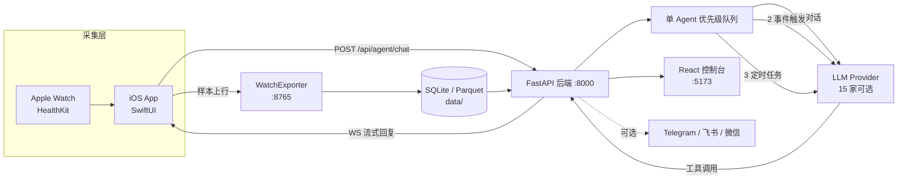

# CareAgent · 本地优先的个人健康 AI Agent

> Apple Watch 的连续健康数据全部留在你自己的机器上，由一个 7×24 常驻的大模型 Agent 读懂睡眠、心率与运动，并主动把结论推到你手机上。

CareAgent 由三部分组成：采集端（iPhone / Apple Watch）、推理端（Python 后端 + 可插拔 LLM）、交付端（iOS App、Web 面板、可选 IM 网关）。

---

## 目录

- [这是什么](#这是什么)
- [核心能力](#核心能力)
- [系统架构](#系统架构)
- [技术栈](#技术栈)
- [目录结构](#目录结构)
- [快速开始](#快速开始)
- [配置说明](#配置说明)
- [iOS / watchOS 客户端](#ios--watchos-客户端)
- [可选：接入 IM](#可选接入-im)
- [开发者指南](#开发者指南)
- [测试](#测试)
- [端口与接口](#端口与接口)
- [安全与限制](#安全与限制)
- [许可](#许可)

---

## 这是什么

市面上的健康 App 大多只做两件事：把原始数字画成图表，或者给出一个不可解释的分数。CareAgent 想做第三件事——**让 AI 直接读你的原始数据，按你自己的问题给出结论**。

数据链路完全本地化：HealthKit 采样经 iPhone 上行到本机运行的 WatchExporter，落进 SQLite / Parquet；后端的一个单实例 Agent 按优先级队列处理"用户提问 → 事件触发 → 定时任务"，调用 LLM 分析后再把结果推回客户端。整个过程不需要把健康数据交给任何第三方云服务，模型调用也可以指向本地 vLLM。

因此它也适合拿来做实验：想加一个"睡眠规律性"指标，写一个 Markdown 技能文件即可；想要一个自定义看板，让 Agent 直接生成页面。

---

## 核心能力

| 能力 | 说明 |
|---|---|
| 可穿戴数据接入 | 心率、HRV、血氧、睡眠分期、运动、活动能力等 50+ 项指标，经 iPhone 持续上行 |
| 自主分析 | 定时任务 + 事件触发，输出带图表的报告，无需人工发起 |
| App 内原生对话 | iOS 内直接聊天，流式回复、图片收发、可折叠的工具调用过程、APNs 离线推送 |
| 多会话管理 | 可新建 / 重命名 / 归档会话；置顶的 CareAgent 会话接收全部定时报告 |
| Web 控制台 | 浅色 / 深色 / 跟随系统；Agent Monitor 把每次对话与后台分析整理成时间线 |
| 个性化健康计划 | 首次启动填写目标问卷，Agent 自动设计周期性随访计划，随时可重新生成 |
| 页面生成 | 通过 `create_page` 工具按需产出单页应用，用于重复性工作流 |
| 技能系统 | 内置 5 个分析 playbook，支持在仓库外追加个人技能 |
| 多模型 | 15 家 Provider 可切换，支持备用模型链与失败重试 |
| 可选 IM 网关 | Telegram / 飞书 / 微信（ClawBot），可与 App 内聊天并存 |

---

## 系统架构



三条贯穿全局的设计约束，改动代码时最好遵守：

1. **单 Agent 顺序执行**。同一时刻只有一个 `AutonomousHealthAgent` 在工作，不引入并行推理线程，避免争抢同一份 LLM 会话。并发只存在于采集、传输与 I/O 层。
2. **优先级队列驱动**。`run_forever()` 固定按"用户对话 > 事件触发 > 定时任务"取任务。新增工作类型应当新增一个队列消费者，而不是新增一个循环。
3. **提示词运行时拼装**。系统提示词不是硬编码的，而是由 `backend/agent/agent_prompts.py` 中的 `LAYER_PLAN` 把 `prompts/` 下的 Markdown 分层组合（soul、rules_chat、sub_analysis、plan_designer、data_schema、memory_guide，加上 Agent 自己维护的 user.md / experience.md）。要改人设或规则，改 Markdown，不改代码。

---

## 技术栈

| 层 | 选型 |
|---|---|
| 后端 | Python 3.10+、FastAPI、Pydantic Settings、APScheduler、SQLite |
| Agent | 自研单实例事件循环，15 家 LLM Provider（OpenAI / Anthropic / Gemini / Vertex / Bedrock / DeepSeek / Groq / Mistral / MiniMax / 智谱 / vLLM / OpenRouter 等） |
| 前端 | React 18、Vite、Tailwind CSS、react-i18next |
| 客户端 | Swift / SwiftUI，iPhone + watchOS + 小组件，WatchConnectivity 同步 |
| 采集服务 | aiohttp（WatchExporter，:8765） |
| 部署 | Docker Compose、`setup.sh` 向导、`hime.sh` 统一 CLI |

---

## 目录结构

```
backend/
  main.py               FastAPI 应用入口、生命周期、cron 调度
  config.py             Pydantic 配置（读取 .env）
  agent/
    autonomous_agent.py 单 Agent 状态机与 run_forever() 事件循环
    agent_loops.py      对话、分析、计划生成三类主循环
    agent_prompts.py    分层提示词拼装（LAYER_PLAN）
    llm/                各家 Provider 实现
    tools/              BaseTool 子类（sql / code / reply_user / push_report / create_page …）
    skills/             技能发现与加载
    memory_manager.py   SQLite：报告、对话历史、问卷、计划、触发器
    data_store.py       健康数据入库
    trigger_evaluator.py 事件触发评估
    fact_verifier.py    对外消息的证据校验
  api/                  FastAPI 路由（agent / data / stream / devices / prompts / skills / pages）
  data_readers/         Apple Watch 数据读取
  messaging/            平台无关的网关抽象、注册表、收件箱
  ios_gateway/          App 内通道（WebSocket 下行 + APNs）
  telegram/  feishu/  weixin/   各 IM 网关实现
frontend/               React 控制台（监控、报告、配置，不含聊天）
ios/
  hime/hime/            iPhone App
  hime/himewatch/       watchOS App
  Server/               WatchExporter（:8765）
prompts/                分层提示词 Markdown
skills/                 分析技能（Markdown + YAML frontmatter）
tests/                  pytest 用例
docs/                   安装、部署、开发文档
hime.sh                 统一开发 CLI
setup.sh                首次安装向导
```

---

## 快速开始

### 前置条件

- Docker Desktop（推荐路径），或 Python 3.10+ 与 Node 20+（原生路径）
- 一个可用的 LLM API Key（也可指向本地 vLLM）
- 可选：Apple Watch + iPhone，用于产生真实数据

### 方式 A：Docker Compose（推荐）

```bash
git clone git@github.com:dreggler/health-care-agent.git
cd health-care-agent
./setup.sh
```

向导会依次完成：环境检查、选择运行模式、选择 LLM Provider、写入 API Key、生成 `API_AUTH_TOKEN`、写 `.env`、构建并启动容器、健康检查。首次构建约 2–5 分钟。

如果更想手工控制，等价于：

```bash
cp .env.example .env
# 至少设置 DEFAULT_LLM_PROVIDER 与对应的 *_API_KEY
docker compose up --build -d
```

### 方式 B：本地原生运行

```bash
python3 -m venv .venv
source .venv/bin/activate
pip install -r backend/requirements.txt
cp .env.example .env        # 按需修改
./hime.sh start             # 同时拉起后端、前端、WatchExporter
```

### 方式 C：只跑后端

```bash
python -m backend.main
# 设置 HIME_DEV_RELOAD=true 可开启 Uvicorn 热重载
```

### 常用运维命令

`hime.sh` 会根据 `.env` 中的 `HIME_RUN_MODE` 自动在 Docker / 原生模式间分发，也可用 `--docker` / `--native` 强制指定。

| 命令 | 作用 |
|---|---|
| `./hime.sh start` | 启动全部服务 |
| `./hime.sh stop` | 停止全部服务（幂等） |
| `./hime.sh restart --rebuild` | 重启并重建镜像，改了代码或 `VITE_*` 变量时用 |
| `./hime.sh restart --clean` | 原生模式下顺带清理 `__pycache__` |
| `./hime.sh status` | 查看运行状态与磁盘占用 |
| `./hime.sh logs backend` | 跟踪日志，服务可选 backend / frontend / watch |
| `./hime.sh forget` | 清空对话历史，**保留**健康数据 |
| `./hime.sh reset` | 清空 Agent 记忆与已采集数据 |

### 验证

- Web 控制台：http://localhost:5173
- 后端：http://localhost:8000/health
- 采集服务：http://localhost:8765/ping

若设置了 `API_AUTH_TOKEN`，控制台首次请求会弹出输入框，粘贴 `.env` 里的值即可，令牌只存在浏览器本地，不会打进前端产物。

---

## 配置说明

所有配置集中在 `.env`，模板见 `.env.example`（其中按 `Required / LLM provider keys / Agent behavior / Storage / Networking / API authentication / 各 IM 网关` 分区，并附有每个 Provider 的模型候选注释）。

### 必填

| 变量 | 说明 |
|---|---|
| `DEFAULT_LLM_PROVIDER` | 主模型 Provider，如 `gemini`、`openai`、`anthropic` |
| `*_API_KEY` | 对应 Provider 的密钥，例如 `GEMINI_API_KEY`、`OPENAI_API_KEY` |

### 常用可选项

| 变量 | 默认 | 说明 |
|---|---|---|
| `DEFAULT_MODEL` | 空 | 覆盖 Provider 的中档默认模型 |
| `FALLBACK_LLM_PROVIDER` | 空 | 主模型连续返回 503/529 时的备用 Provider |
| `API_AUTH_TOKEN` | 空 | 设置后 `/api/*` 需 `Authorization: Bearer`，WebSocket 用 `?token=` |
| `CORS_ORIGINS` | 本地两项 | JSON 数组字符串，公网部署时加入你的域名 |
| `DATA_STORE_PATH` | `./data/data_stores` | 健康数据落盘位置 |
| `MEMORY_DB_PATH` | `./memory` | Agent 记忆与状态 |
| `AGENT_LOGS_PATH` | `./logs` | 日志与 LLM 用量 CSV |
| `DATA_RETENTION_DAYS` | 30 | 滚动保留窗口 |
| `IOS_GATEWAY_ENABLED` | `true` | App 内聊天通道 |
| `IOS_VISION_ENABLED` | `false` | 允许聊天中上传图片，需视觉模型 |
| `CODE_TOOL_DOCKER_SANDBOX` | `false` | 代码工具的执行沙箱，公网部署请设为 `true` |

---

## iOS / watchOS 客户端

### 从源码构建

```bash
cp ios/hime/Config.xcconfig.template ios/hime/Config.xcconfig
# 编辑 Config.xcconfig，填入 DEVELOPMENT_TEAM 与 BUNDLE_ID_PREFIX
```

用 Xcode 16+ 打开 `ios/hime/hime.xcodeproj`，⌘R 运行。Bundle ID 会由 `BUNDLE_ID_PREFIX` 自动派生。

> 不要在 Xcode 的 Signing & Capabilities 里改 Team——`project.pbxproj` 故意不存 Team ID，Xcode 会从 `Config.xcconfig` 读取。手动改会被写回 pbxproj，破坏"个人 Team ID 不入库"的设计。

### 连接后端

App 的 Settings → Server URL 支持四种写法：

- `localhost` —— 模拟器与本机后端
- `192.168.1.100` —— 同一 Wi-Fi 下的局域网地址
- `homelab.local` —— 局域网 mDNS 主机名
- `example.com` —— 公网域名，会自动派生 `api.` 与 `wss://watch.`

若服务端设置了 `API_AUTH_TOKEN`，把同一个值填进 Settings → Auth Token。

---

## 可选：接入 IM

不装 App 也能用。三条通道任选其一即可，也可以与 App 内聊天并存。

- **Telegram**：向 [@BotFather](https://t.me/BotFather) 建 bot 拿 token，向 [@userinfobot](https://t.me/userinfobot) 拿 chat_id，然后在 `.env` 里开 `TELEGRAM_GATEWAY_ENABLED=true` 并填 `TELEGRAM_TOKEN`、`CHAT_ID`、`TELEGRAM_ALLOWED_CHAT_IDS`。
- **飞书**：在 [open.feishu.cn](https://open.feishu.cn) 建自建应用，取 `APP_ID` / `APP_SECRET`，事件订阅选"长连接"（无需公网回调），把 bot 拉进群后填 `FEISHU_DEFAULT_CHAT_ID`。
- **微信**：走官方 ClawBot 插件，无需开发者后台。设 `WEIXIN_GATEWAY_ENABLED=true` 后执行 `python -m backend.weixin.qr_login`（Docker 下为 `docker exec -it hime-backend python -m backend.weixin.qr_login`），用微信扫码，token 会写入 `data/weixin_bot_token.json`。仅支持文本，主动推送要求用户先发过消息。

细节与排错见 [`docs/INSTALL.md`](docs/INSTALL.md)。

---

## 开发者指南

### 加一个工具

1. 在 `backend/agent/tools/` 新建类，继承 `BaseTool`，实现 `name`、`get_definition()`、`async execute(**kwargs)`。
2. 把 JSON Schema 补进 `backend/agent/tools/tools.json`。
3. 在 `backend/agent/tools/registry.py` 的 `with_default_tools` 中注册。
4. 如果只对某个模式可见，加入 `backend/agent/agent_tools.py` 对应的工具集。

### 加一个 Provider

1. 在 `backend/agent/llm/` 新建模块，实现 `BaseLLMProvider`。
2. 用 `@register_provider("your_provider")` 装饰。
3. 在 `.env.example` 补上密钥变量与该 Provider 的默认模型。

### 改提示词

在 `prompts/` 下新增 Markdown，并在 `agent_prompts.py` 的 `LAYER_PLAN` 里加一行即可，无需改动调用方。

### 前端调试

```bash
cd frontend
npm install
npm run dev     # /api/* 默认代理到 http://localhost:8000，可用 VITE_API_TARGET 覆盖
```

更多内容见 [`docs/DEVELOPMENT.md`](docs/DEVELOPMENT.md)。

---

## 测试

```bash
pip install pytest pytest-asyncio
pytest                    # 35 个测试文件，默认从 tests/ 收集
pytest -m "not slow"      # 跳过慢用例
```

---

## 端口与接口

| 端口 | 服务 |
|---|---|
| 8000 | FastAPI 后端 |
| 5173 | Vite 开发服务器 / 控制台 |
| 8765 | WatchExporter（健康样本上行） |

主要接口：

| 方法与路径 | 用途 |
|---|---|
| `GET /health` | 健康检查 |
| `POST /api/agent/chat` | 发送对话消息 |
| `POST /api/agent/start` | 启动 Agent |
| `GET /api/agent/status` | Agent 运行状态 |
| `WS /api/stream/agent/{user_id}` | 对话流式下行 |
| `WS /api/stream/data` | 数据流 |
| `POST /api/devices/register` | 注册 APNs 设备令牌 |
| `GET /api/personalised-pages/list` | 已生成的个性化页面 |
| `GET /api/data/*` | 健康数据查询 |
| `GET /api/prompts`、`GET /api/skills` | 提示词与技能管理 |

---

## 安全与限制

- **代码工具默认在进程内执行**。单人使用、只有你能给 Agent 发消息时风险可控；一旦开放给他人或暴露公网，请设置 `CODE_TOOL_DOCKER_SANDBOX=true`，用容器隔离执行。
- **公网部署必须设置 `API_AUTH_TOKEN`**，并把 8000 / 8765 绑定在 `127.0.0.1` 后由 nginx / Caddy 反代，不要在公网直接暴露服务端口。
- **Agent 的输出不是医疗建议**。本项目是研究级软件，不做诊断，也不能替代医生。
- 数据默认保留 30 天（`DATA_RETENTION_DAYS`），备份与升级策略见 [`docs/DEPLOYMENT.md`](docs/DEPLOYMENT.md)。

---

## 许可

本项目仅供个人学习与非商业用途使用，不附带独立许可文件。如需商业授权，请通过仓库 Issues 联系维护者。
